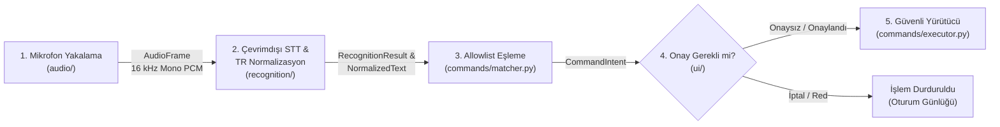

# Offline Voice Commands TR — Çevrimdışı Türkçe Konuşmadan Yazıya ve Güvenli Komut Sistemi


Kullanıcının mikrofondan yaptığı konuşmayı **tamamen çevrimdışı (internetsiz)** olarak Türkçe metne dönüştüren ve üretilen metin **yalnızca sabit izin listesindeki (Allowlist) dört komuttan biriyle** eşleştiğinde ilgili uygulama içi güvenli işlemi (riskli işlemlerde açık kullanıcı onayıyla) yürüten masaüstü uygulaması.

---

## 1. Mimari Yaklaşım ve Güvenlik İlkeleri (Security & Privacy by Design)

Sistem, sesli asistanlarda sıkça karşılaşılan **yanlış pozitif komut tetiklenmesi (false-positive execution)**, **komut enjeksiyonu** ve **veri gizliliği** risklerini mimari düzeyde ortadan kaldırmak üzere tasarlanmıştır:

- **Sıfır İşletim Sistemi / Kabuk Çağrısı (No-Shell Execution):** Uygulama içinde `subprocess`, `os.system`, `shell=True`, `eval` veya `exec` çağrıları kesinlikle yer almaz. Komut yürütücü (`SafeCommandExecutor`), yalnızca `CommandId` enum değerlerine bağlı dahili Python fonksiyonlarını tetikler.
- **Ham Ses Gizliliği (Zero Raw-Audio Persistence):** Mikrofondan yakalanan 16 kHz mono PCM ses çerçeveleri (`AudioFrame`) yalnızca bellekteki sınırlı bir halka kuyrukta (ring buffer) işlenir; varsayılan olarak diske hiçbir `.wav` veya `.pcm` dosyası yazılmaz.
- **Tam Çevrimdışı İşleme (100% Offline STT):** Konuşma tanıma işlemi yerel Vosk Türkçe dil modeli (`vosk-model-small-tr-0.3`) ile cihaz üzerinde gerçekleştirilir; dış ağlara veya bulut API'lerine veri gönderilmez.
- **Çift Kademeli Komut Kilidi (Mod + Allowlist + Onay):**
  1. **Dikte Modu (Varsayılan):** Konuşulan ifadeler yalnızca metin alanına aktarılır; hiçbir komut tetiklenmez.
  2. **Komut Modu:** Yalnızca kullanıcı tarafından etkinleştirildiğinde çalışır. Güven eşiğinin (`min_confidence`) altındaki veya izin listesindeki 4 ifade dışında kalan tüm cümleler (`unknown_command`) reddedilir.



---

## 2. İzin Verilen Komut Kataloğu (Allowlist)

Komut modu açıkken yalnızca aşağıdaki **4 tanımlı Türkçe ifade** komuta dönüştürülebilir. Diğer tüm ifadeler (ör. `"bilgisayarı kapat"`, `"dosyayı sil"`) kesin olarak reddedilir:

| Tanımlı Türkçe İfade | Komut Kimliği (`CommandId`) | Uygulama İçi İşlev | Kullanıcı Onayı |
|---|---|---|---|
| **`"dinlemeyi durdur"`** | `STOP_LISTENING` | Aktif mikrofon akışını kapatır ve dinlemeyi sonlandırır | Onaysız |
| **`"son cümleyi sil"`** | `DELETE_LAST_SENTENCE` | Metin alanındaki son nihai cümleyi kaldırır | Onaysız |
| **`"metni temizle"`** | `CLEAR_TEXT` | Metin alanının tamamını temizler | **Onay İster** |
| **`"metni kaydet"`** | `SAVE_TEXT` | Metni kullanıcının seçtiği konuma `.txt` olarak kaydeder | **Onay İster** |

---

## 3. Modüler Proje Yapısı ve Sorumluluk Sınırları

Proje, modüllerin birbirini beklemeden paralel geliştirilebilmesi için **Ortak Veri Sözleşmeleri (`contracts/`)** ve **Sahte Sağlayıcılar (Fake Providers)** üzerine inşa edilmiştir:

```text
.
├── app.py                      # Uygulama giriş noktası (--fake ve --check modlarını destekler)
├── config.example.json         # Örnek yapılandırma dosyası (sabit dosya yolu içermez)
├── requirements.txt            # Sabitlenmiş paket bağımlılıkları (vosk, sounddevice)
├── contracts/                  # Modüller arası veri sözleşmeleri ve arayüz protokolleri
│   ├── models.py               # AudioConfig, AudioFrame, RecognitionResult, CommandIntent vb.
│   └── interfaces.py           # AudioSourceProtocol, SpeechRecognizerProtocol vb.
├── core/                       # Yapılandırma yükleyici ve modülleri bağlayan koordinatör (glue)
│   ├── config.py
│   └── controller.py
├── audio/                      # [K1] Mikrofon listeleme, 16 kHz mono akış, sınırlı kuyruk ve sahte kaynak
├── recognition/                # [K2] Vosk çevrimdışı model yükleme, kısmi/nihai metin ve TR normalizasyon
├── commands/                   # [K3] Allowlist eşleyici (matcher) ve güvenli yürütücü (executor)
├── ui/                         # [K3] Tkinter/ttk masaüstü arayüzü, durum göstergeleri ve oturum günlüğü
├── assets/ui/                  # [K3] Arayüz görsel yardımcıları
├── fixtures/                   # Entegrasyon ve birim testleri için standart 16 kHz mono WAV ve metin verileri
│   ├── audio/
│   └── text/
├── docs/                       # Modül teknik dokümantasyonu ve doğrulama kayıtları
└── tests/
    └── integration/            # Sözleşme uyumluluğu, 10 bilinmeyen cümle reddi ve AST güvenlik testleri
```

| Modül Alanı | Sorumlu | GitHub Kullanıcısı | Kapsam |
|---|---|---|---|
| `contracts/`, `core/`, `app.py`, `fixtures/`, `tests/` | Proje Lideri | `@frkn-mt-tpkr` | Veri sözleşmeleri, mimari koordinasyon, entegrasyon ve kalite kapıları |
| `audio/`, `docs/audio/` | K1 — Ses ve Mikrofon | `@TheletterM16` | Cihaz yönetimi, 16 kHz mono PCM çerçeve üretimi, halka kuyruk ve cihaz hata kodları |
| `recognition/`, `docs/recognition/` | K2 — Konuşma Tanıma | `@omerkonacoglu` | Vosk Türkçe model yönetimi, çevrimdışı çözümleme, Türkçe normalizasyon (`İ/ı`) ve güven eşiği |
| `commands/`, `ui/`, `assets/ui/`, `docs/interaction/` | K3 — Komut ve Arayüz | `@iremsutavuz26` | Tkinter masaüstü arayüzü, allowlist eşleme, onay mekanizması ve güvenli eylem yürütme |

---

## 4. Kurulum ve Çalıştırma

### 4.1. Depoyu Klonlama ve Sanal Ortam Kurulumu

```bash
git clone https://github.com/frkn-mt-tpkr/offline-voice-commands-tr.git
cd offline-voice-commands-tr
```

**Windows (PowerShell):**
```powershell
python -m venv .venv
.\.venv\Scripts\Activate.ps1
pip install -r requirements.txt
```
> *Not:* PowerShell üzerinde betik çalıştırma kısıtlaması (`ExecutionPolicy`) uyarısı alırsanız `Set-ExecutionPolicy -ExecutionPolicy RemoteSigned -Scope CurrentUser` komutunu çalıştırdıktan sonra sanal ortamı etkinleştirebilirsiniz.

**macOS / Linux:**
```bash
python3 -m venv .venv
source .venv/bin/activate
pip install -r requirements.txt
```

### 4.2. Çevrimdışı Türkçe Dil Modelinin Kurulumu (Vosk)
Dil modeli dosyaları boyutu nedeniyle Git deposunda tutulmaz.

1. [Vosk Models](https://alphacephei.com/vosk/models) sayfasından **[`vosk-model-small-tr-0.3.zip`](https://alphacephei.com/vosk/models/vosk-model-small-tr-0.3.zip)** (~35 MB, Apache 2.0) arşivini indirin.
2. Proje kök dizininde `models/` klasörü oluşturup arşivi aşağıdaki dizin yapısıyla çıkarın:
   ```text
   offline-voice-commands-tr/
   └── models/
       └── vosk-model-small-tr-0.3/
           ├── am/
           ├── conf/
           ├── graph/
           └── ivector/
   ```
3. Farklı bir model konumu kullanmak isterseniz `config.example.json` dosyasını `config.local.json` olarak kopyalayıp `"model_path"` alanını güncelleyebilir veya `VOSK_MODEL_PATH` ortam değişkenini tanımlayabilirsiniz.

### 4.3. Uygulamayı ve Testleri Çalıştırma

```bash
# Masaüstü arayüzünü başlatma:
python app.py

# Donanım veya model olmadan sahte sağlayıcılarla (Fake Providers) başlatma:
python app.py --fake

# Sözleşme ve başlangıç doğrulamasını arayüzsüz çalıştırma:
python app.py --check

# Entegrasyon ve AST güvenlik taraması testlerini çalıştırma:
python -m unittest discover -s tests/integration -p "test_*.py" -v
```

---

## 5. Geliştirme ve Dal (Branch) İş Akışı

Projede `main` dalı yalnızca doğrulanmış sürümleri barındırır. Haftalık geliştirmeler ilgili `week/X` entegrasyon dalında toplanır:

1. Yeni bir görev (Issue) için güncel `main` dalından kişisel görev dalı açılır:
   ```bash
   git switch main
   git pull origin main
   git switch -c e1/issue-1-mic-capture
   ```
2. Yalnızca görev kapsamındaki izinli klasörlerde geliştirme yapılır ve manuel doğrulama tamamlanır.
3. Değişiklikler ilgili haftanın entegrasyon dalına (`base: week/1`, `week/2` vb.) Pull Request olarak gönderilir.
4. Her Pull Request, GitHub Actions üzerindeki **PR Ownership & Security Guard** (`.github/workflows/pr_guard.yml`) tarafından klasör sahipliği, dal hedefi ve güvenlik kuralları açısından otomatik olarak denetlenir.

Ayrıntılı çalışma kuralları için:
- Katılımcı ve Coding Agent rehberi: [`TEAM_MEMBER.md`](TEAM_MEMBER.md)
- Lider ve entegrasyon rehberi: [`LEADER.md`](LEADER.md)
